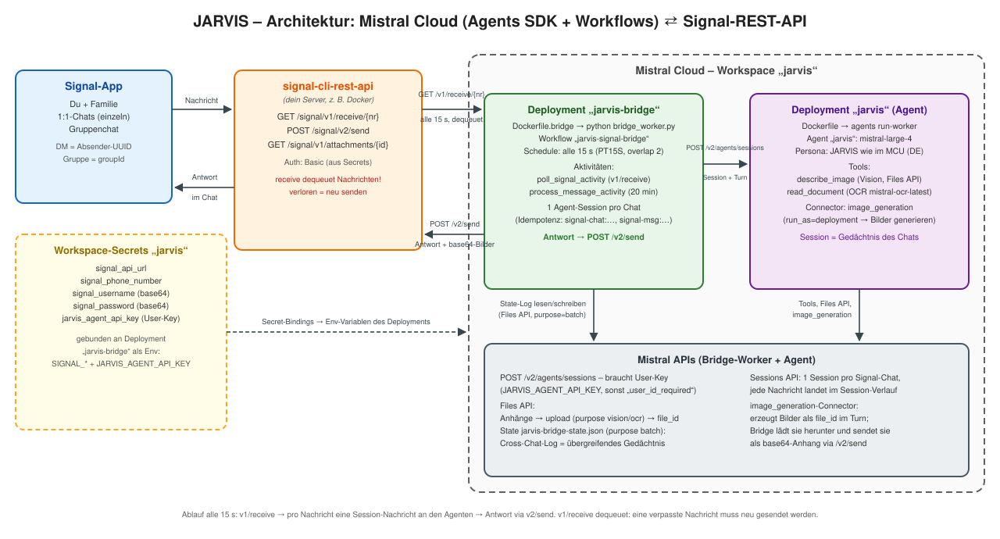

# JARVIS – persönlicher KI-Assistent auf Mistral Cloud (mit Signal)

JARVIS ist ein Agent auf Basis des **Mistral Agents SDK** (`mistralai-agents`), der als
**verwaltete Bereitstellung (managed deployment)** auf Mistral Cloud läuft und über eine
**Signal-REST-API** erreichbar ist: 1:1-Chats mit einzelnen Familienmitgliedern und Gruppenchats.

## Architektur

```
Signal-App ──► signal-cli-rest-api ──GET /v1/receive──┐
                                                       ▼
                                     ┌──────────────────────────────┐
                                     │ Managed Deployment "jarvis"  │
                                     │  Workflow "jarvis-signal-    │
                                     │  bridge" (Schedule: PT5S)   │
                                     │   poll → pro Chat eine Agent- │
                                     │   Session → Antwort via       │
                                     │   POST /v2/send               │
                                     │  Agent "jarvis" (Agents SDK) │
                                     │   Tools: describe_image,     │
                                     │   read_document (OCR),       │
                                     │   web_search, generate_image,│
                                     │   search_knowledge           │
                                     └──────────────────────────────┘
```



- **Agent `jarvis`** (`main.py`): Modell `mistral-large-4`, Persona und Regeln in den Instructions.
- **Bridge-Workflow `jarvis-signal-bridge`** (`bridge.py`): wird alle 5 s per Schedule (`PT5S`) ausgeführt,
  pollt `GET /v1/receive/{number}`, verarbeitet jede neue Nachricht und antwortet über `POST /v2/send`.
  Dabei: Schreib-Indikator an beim Verarbeiten (`PUT /v1/typing-indicator/{number}`), aus nach der
  Antwort (`DELETE`), und „gelesen“-Receipt nach der Antwort (`POST /v1/receipts/{number}`, receipt_type=read).
- Pro Signal-Chat (DM = Absender-UUID, Gruppe = groupId) wird **eine Agent-Session** geführt
  (`start_session(idempotency_key="signal-chat:<chat>")`) – dadurch merkt sich JARVIS jedes Gespräch.
  Idempotency-Keys sorgen dafür, dass weder Sessions noch Nachrichten doppelt angelegt werden.
- **Übergreifendes Gedächtnis**: Die Bridge führt ein Kurzprotokoll aller Chats (`log` in
  `state_store`, als JSON in einem Dokument der Mistral-Library `jarvis-bridge-state`) und packt die letzten Einträge jeder
  Nachricht als Kontext mit hinein. So weiß JARVIS, mit wem er schreibt und was mit den anderen
  Personen besprochen wurde.
- **Bilder**: verstehen via `describe_image` (Vision), generieren via `generate_image`
  (eingebautes `image_generation`-Tool über die Conversations-API). Generierte Bilder werden als
  Anhang zurück in den Signal-Chat geschickt.
- **Websuche**: Tool `web_search` (eingebautes `web_search`-Tool über die Conversations-API) für
  aktuelle Infos (Wetter, Nachrichten, Preise etc.).
- **Libraries (Familien-Wissen)**: Tool `search_knowledge` (eingebautes `document_library`-Tool über
  die Conversations-API) durchsucht die Libraries „Dokumente zu <Name>“, „Allgemeine Dokumente“
  und „Sonstiges“. Damit der Deployment-Service-Account lesen darf, müssen die Libraries mit dem
  Workspace `jarvis` geteilt sein (Viewer reicht).
- **Dokumente automatisch ablegen**: Bei jedem Dokument-Anhang (kein Bild/Video/Audio) entscheidet die
  Bridge per LLM (`classify_document`), ob das Dokument in eine der Libraries gehört, und lädt es mit
  dem User-Key dort hoch (`upload_document_to_library`). Die Ablage landet im Kurzprotokoll-Log und
  damit im Kontext der anderen Chats. `filed` im Execution-Result zeigt die Anzahl.
- **PDFs/Dokumente**: `read_document` (Mistral OCR, `mistral-ocr-latest`).
- **Sprachnachrichten**: werden von der Bridge per Mistral Voxtral (`/v1/audio/transcriptions`) transkribiert und als Text in den Kontext-Block gepackt.

## Voraussetzungen

1. Eine laufende **Signal-REST-API**, z. B. [signal-cli-rest-api](https://github.com/bbernhard/signal-cli-rest-api)
   im Docker-Container (`MODE=native` oder `normal`), erreichbar für die Mistral-Cloud
   (z. B. über einen Tunnel/Reverse-Proxy auf deinem Server – nur von Mistral aus erreichbar, nicht öffentlich indexiert).
   Registrierte Nummer z. B. `+49…`.
2. **Vier Workspace-Secrets** in Mistral Studio ([console.mistral.ai → Secrets](https://console.mistral.ai/secrets)):
   - `signal_api_url` – Basis-URL der Signal-REST-API, z. B. `https://signal-api.example.internal:8080`
   - `signal_phone_number` – die registrierte Nummer, z. B. `+49123456789`
   - `signal_username` – Username für Basic-Auth, **base64-kodiert**
   - `signal_password` – Passwort für Basic-Auth, **base64-kodiert**

   Daraus baut die Bridge den Header `Authorization: Basic base64(user:pass)`.
   Werte niemals in den Chat/ ins Repo schreiben – die Bridge liest sie zur Laufzeit aus der Umgebung.
   - `jarvis_agent_api_key` – dein persönlicher Mistral-API-Key (User-Key), an das Deployment
     `jarvis-bridge` als `JARVIS_AGENT_API_KEY` gebunden. Die Bridge braucht ihn, weil Agent-Sessions
     nur als User (nicht als Service Account des Deployments) gestartet werden dürfen (`user_id_required`).
3. Ein **GitHub-Repository**, das der GitHub-Connector (`github_app`) in diesem Workspace lesen darf.

## Deployment (verwaltet)

```bash
# 1. lokal testen (optional)
cp .env.example .env   # MISTRAL_API_KEY eintragen
uv sync
uv run --env-file .env agents info
uv run --env-file .env python -c "import bridge"  # Bridge importieren (Syntax/Discovery)

# 2. Agenten-Deployment anlegen (reines Workflows-Deployment, z. B. via MCP/UI):
#    deploy_workflow_deployment(deployment_name="jarvis", github_url=<repo>, revision=<SHA>,
#    dockerfile_path="Dockerfile") – der Worker pollt die Queue "jarvis".
#    Die Agent-Registrierung (POST /v2/agents/agents/register, Bindung Name → Queue "jarvis")
#    übernimmt die Bridge selbst beim Worker-Start mit JARVIS_AGENT_API_KEY
#    (bridge_worker.py → ensure_agent_registered); `agents deploy` ist nicht nötig.
#    Alternativ geht auch: uv run --env-file .env agents deploy . --name jarvis
```

Die **Bridge** (`jarvis-bridge`) wird dagegen als reines Workflows-Deployment angelegt,
z. B. über die Workflows-API/MCP:

```
deploy_workflow_deployment(
  deployment_name="jarvis-bridge",
  github_url="https://github.com/andrekrug42/jarvis-agent",
  revision=<Commit-SHA>,
  build_directory=".",
  dockerfile_path="Dockerfile.bridge",
)
# Secrets in der Studio-UI binden (Deployment jarvis-bridge → Settings → Secrets):
#   SIGNAL_API_URL ← signal_api_url, SIGNAL_PHONE_NUMBER ← signal_phone_number,
#   SIGNAL_USERNAME ← signal_username, SIGNAL_PASSWORD ← signal_password,
#   JARVIS_AGENT_API_KEY ← jarvis_agent_api_key, JARVIS_ALLOWED_CHATS ← jarvis_allowed_chats
# An der Agent-Deployment jarvis nur: JARVIS_AGENT_API_KEY ← jarvis_agent_api_key
# (proaktives Signal-Senden läuft über die Outbox im State – die Bridge hat die SIGNAL_*-Secrets
# und ist die einzige Stelle, die mit der Signal-API spricht)
# dann Deployment neu starten (stop/start), damit die Env-Variablen injiziert werden
```

Danach den Bridge-Workflow **schedulen** (alle 5 s, `PT5S`):

```
workflow_identifier: jarvis-signal-bridge
deployment_name: jarvis-bridge
schedule: { input: {}, intervals: [{ every: "PT5S" }], policy: { overlap: 2 } }
```

## Mit JARVIS sprechen

- **Über Signal**: einfach eine Nachricht an die registrierte Nummer schreiben – 1:1 oder in einer Gruppe.
- **Über Vibe / Mistral**: nach dem Deploy erscheint der Agent in den Managed Agents:
  - Vibe Code Web / Chat: `https://chat.mistral.ai/managed-agents/jarvis?source=agents_api`
  - CLI: `agents chat jarvis` (mit `MISTRAL_API_KEY`)
  - Programmatisch: `agents.Agent.load_from(agent_name="jarvis")` + `start_session()` / `run(...)`
  - In Vibe mit verbundenem Mistral-MCP: `list_workflows` zeigt `jarvis` (Agent) und `jarvis-signal-bridge`;
    mit `execute_workflow` lässt sich der Bridge-Workflow manuell einmal auslösen (Test).
- **Sessions/Traces** prüfen: [console.mistral.ai → Managed Agents → Sessions](https://console.mistral.ai/build/managed-agents/sessions)

## Proaktiv per Signal nachrichten (Outbox)

„Schreib Melina, dass …“ / „Sag der Gruppe, dass …“: Der Agent legt die Nachricht per Tool
`send_signal_message(target, message)` in die **Outbox** im State-Dokument (`outbox`). Die Bridge liest
sie bei jedem Lauf (alle 5 s), löst das Ziel per `resolve_target` auf, prüft die Allowlist und sendet per
`/v2/send`; bei Fehler/nicht erlaubtem Ziel meldet sie es per DM an den Account-Inhaber. Nur die Bridge
braucht dafür die `SIGNAL_*`-Secrets.

## Zeitgesteuerte Aufgaben

„Erinnere mich morgen um 8 Uhr daran, …“ / „Prüfe Dienstag um 9 Uhr …“ / „Schreibe Freitag eine E-Mail an …“:
Der Agent legt die Aufgabe per Tool `schedule_task(when_iso, action, target)` im Bridge-State ab
(`tasks` im State-Dokument). Die Bridge prüft bei jedem Lauf (alle 5 s), ob Aufgaben fällig sind, führt sie
über die jeweilige Chat-Session des Ziel-Chats aus (`[AUFGABE …]`-Prompt) und schickt das Ergebnis automatisch
per Signal an den Ziel-Chat. Das Ziel wird dabei strikt gegen die Allowlist geprüft (`resolve_target`).

## Weitere Tools ergänzen

Ein Tool ist eine Python-Funktion mit `@agents.tool` (typisierte Parameter + Docstring) in
`agent_tools.py`, eingetragen in `Agent(tools=[...])` in `main.py`. Beispiel:

```python
@agents.tool
async def get_weather(city: str) -> dict:
    """Aktuelles Wetter für eine Stadt."""
    ...
```

Danach Commit pushen und erneut deployen (`agents deploy . --name jarvis …` mit denselben
`--secret-binding`s) – die bestehende Bereitstellung wird aktualisiert.

## Umgebungsvariablen

| Variable | Pflicht | Bedeutung |
| --- | --- | --- |
| `SIGNAL_API_URL` | ja | Basis-URL der Signal-REST-API (ohne `/v1`/`/v2`) |
| `SIGNAL_PHONE_NUMBER` | ja | registrierte Signal-Nummer im internationalen Format |
| `SIGNAL_USERNAME` | ja* | Username für Basic-Auth, base64-kodiert (*oder `SIGNAL_API_KEY`) |
| `SIGNAL_PASSWORD` | ja* | Passwort für Basic-Auth, base64-kodiert |
| `SIGNAL_API_KEY` | nein | API-Key der REST-API als Alternative zu Basic-Auth |
| `SIGNAL_AUTH_HEADER` | nein | Header-Name für den Key, Standard `Authorization` |
| `SIGNAL_AUTH_PREFIX` | nein | Präfix des Header-Werts, Standard `Bearer ` |
| `SIGNAL_ALLOWED_SOURCES` | nein | kommaseparierte UUIDs/Nummern, die JARVIS beantworten darf; leer = alle |
| `JARVIS_ALLOWED_CHATS` | nein | **Allowlist (Sicherheit)**: kommaseparierte Chats, die JARVIS beantwortet bzw. proaktiv anschreiben darf – `dm:<uuid|nummer>`, `group:<id|name>`, oder Namen (`Andre,Melina,…,group:Die Kruhsohs`; Namen werden per `/v1/contacts` + `/v1/groups` aufgelöst). Leer = fail-closed: alle Chats blockiert (Owner bekommt eine DM). Als Workspace-Secret `jarvis_allowed_chats` an die Bridge binden; Änderungen greifen nach Redeploy. Nicht erlaubte Chats bekommen keine Antwort, keinen Schreib-Indikator, keine Lesebestätigung und keine proaktiven Nachrichten (Outbox/Tasks) |
| `JARVIS_AGENT_NAME` | nein | Name des Agenten, Standard `jarvis` |
| `JARVIS_AGENT_API_KEY` | ja (Bridge) | User-API-Key für `Agent.load_from`/`start_session` (Sessions nur als User möglich); Fallback: Service-Account-Token des Deployments |
| `JARVIS_OWNER_NAME` | nein | Name des Account-Inhabers für den Kontext |
| `JARVIS_OWNER_UUID` | ja (Bridge) | Signal-UUID des Account-Inhabers (Andre). Nur dieser bekommt Owner-DMs: 📬 Postfach-Benachrichtigungen (nur wenn MAILS > 0), ⚠️ Fehler-DMs (z. B. Task-Fehler) und die einmalige Warnung bei leerer/fail-closed Allowlist. Es gibt keinen hartkodierten Default mehr im Repo – als Secret `JARVIS_OWNER_UUID` an die Bridge binden, sonst sind Owner-DMs deaktiviert (ein Hinweis im Log) |
| `JARVIS_MAILBOX_INTERVAL_SECONDS` | nein | Intervall des autonomen Postfach-Checks in Sekunden, Standard `3600` (1× pro Stunde) |
| `JARVIS_MAILBOX_MAX_MESSAGES` | nein | max. unbearbeitete Mails pro Postfach-Check, Standard `10` |
| `JARVIS_SEARCH_MODEL` | nein | Modell für web_search/search_knowledge/read_document-QA, Standard `mistral-medium-latest` |
| `JARVIS_IMAGE_MODEL` | nein | Modell für generate_image, Standard `mistral-large-4` |
| `JARVIS_VISION_MODEL` | nein | Modell für describe_image (Bildverstehen), Standard `mistral-large-4` |
| `JARVIS_CLASSIFY_MODEL` | nein | Modell für Dokument-Klassifizierung (Auto-Ablegen), Standard `mistral-small-latest` |
| `JARVIS_TASK_PARSE_MODEL` | nein | Modell für Zeitangaben-Parsing in schedule_task, Standard `mistral-small-latest` |
| `JARVIS_AUDIO_MODEL` | nein | Modell für Sprachnachrichten-Transkription, Standard `voxtral-mini-latest` |

## Entwicklung

Lokale Checks (identisch zur CI in `.github/workflows/ci.yml`):

```bash
uv sync --frozen --group dev
uv run python -m py_compile main.py bridge.py bridge_worker.py agent_tools.py state_store.py signal_client.py
uv run ruff check .            # volle Regeln (E, F, W, I, UP, B)
uv run ruff format --check .
uv run pytest -q
uv run mypy signal_client.py state_store.py
```

Auto-Fix/Format lokal: `uv run ruff check --fix .` und `uv run ruff format .`

## Hinweise

- Der Bridge-Workflow läuft als Deployment-Identität (Service Account) – daher
  `run_as="deployment"` beim image_generation-Connector und `RunAs.DEPLOYMENT` für eigene
  Mistral-API-Aufrufe in Tools. Es wird keine On-behalf-of-Anmeldung benötigt, das Deployment
  ist daher nicht gehärtet (hardened).
- Sessions enden spätestens nach 24 h idle bzw. 1 Woche gesamt (Maximum bei verwalteten
  Deployments, gesetzt im Dockerfile). Danach startet die Bridge automatisch eine neue Session;
  das Chat-Protokoll bleibt im Bridge-Log erhalten.
- Antworten können durch das 5-s-Polling (Schedule `PT5S`) plus Verarbeitungszeit bis zu ~10–15 s dauern.
  Latenz-Optimierung: Der State wird pro Run nur noch einmal geladen und an alle Activities durchgereicht
  (statt 3–4× pro Run), der GitHub-HEAD-Check für die Session-Epoche ist 60 s gecacht, die Antwort wird
  direkt per `/v2/send` geschickt (Outbox nur noch für proaktive Nachrichten), und Outbox/Tasks-Checks
  werden übersprungen, wenn nichts ansteht.
- Detaillierte Verhaltensregeln (E-Mail/Postfach/Kalender, inkl. Postfach-Check mit Snippet-first)
  liegen im Library-Dokument `JARVIS-Verhaltensregeln.md` (Library „Allgemeine Dokumente`) –
  der Agent liest sie per `search_knowledge` bei Bedarf; die Instruktionen in `main.py` halten nur die Kurzfassung.
